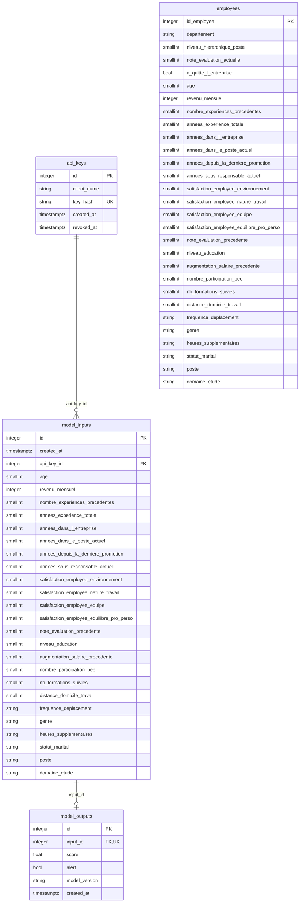

# Attrition model deployment

Serves the employee attrition model from project 4 (CatBoost pipeline) behind a FastAPI API.
The API takes the raw employee fields, applies the feature engineering and the model on the
server side, and returns a score and an alert flag. Every input and output is logged in
PostgreSQL. The alert threshold is read from the model metadata (`models/attrition_metadata.json`),
not from the code. Project 5 of the OpenClassrooms AI Engineer course.

Stack: Python 3.12, uv, FastAPI, SQLAlchemy, PostgreSQL, pytest, Docker Compose, GitHub Actions.

## Quick start

The deployment needs Docker, the `docker-compose.yml` of a release and a `.env` file next to it.
The repository itself is not needed.

Download the Compose file of the release, here `v0.7.0`:

```bash
curl -fsSLO https://raw.githubusercontent.com/dapitch666/oc-p05-attrition-ml-deployment/v0.7.0/docker-compose.yml
```

Create a `.env` file in the same folder:

```text
APP_ENV=prod
POSTGRES_USER=attrition
POSTGRES_PASSWORD=<password of the database owner>
POSTGRES_DB=attrition
APP_DB_PASSWORD=<password of the application role>
```

Start the stack:

```bash
docker compose up -d
```

Three services start in order. `db` is PostgreSQL. `init` runs once, creates the tables,
the `attrition_app` role and, if the database holds no API key, a first key named
"Initial key". `api` starts when `init` has finished and connects as `attrition_app`.

Read the first key in the logs of `init`. It is printed once and cannot be recovered:

```bash
docker compose logs init
```

Check the API and call it with the key:

```bash
curl http://127.0.0.1:8000/health
curl -X POST http://127.0.0.1:8000/predict \
  -H "X-API-Key: <key>" -H "Content-Type: application/json" \
  -d @employee.json
```

`employee.json` holds the body described in the API section below. Running
`docker compose up -d` again re-runs `init`, which changes nothing and prints no new key.

## Configuration

The variables of `.env`, read by `docker-compose.yml`:

- `APP_ENV`: required, `dev`, `test` or `prod`. The API refuses to start otherwise.
- `POSTGRES_USER`, `POSTGRES_PASSWORD`, `POSTGRES_DB`: the PostgreSQL owner account and the
  database created at the first start. `init` and the key commands use this account.
- `APP_DB_PASSWORD`: password of the `attrition_app` role, which `init` creates or updates.
  The API connects with this role.
- `API_BIND`: interface the API port is published on. The default is `127.0.0.1`. Set it to
  `0.0.0.0` to reach the API from the network, for example on a NAS.
- `API_PORT`: host port of the API. The default is `8000`.

The passwords are inserted into connection URLs: they must not contain `@`, `/` or `:`.
`docker-compose.yml` stops with a message when a required variable is missing.

`.env.example` in the repository also lists `DATABASE_URL`, `DATABASE_ADMIN_URL` and
`TEST_DATABASE_URL`. Only development and the tests use them.

## API

`GET /health` is open. It returns the status, the version of the application, read from the
package metadata, and the environment, read from `APP_ENV`:

```json
{"status": "ok", "version": "0.7.0", "environment": "prod"}
```

`POST /predict` needs the key in the `X-API-Key` header. The body is the raw employee fields,
for example:

```json
{
  "age": 35,
  "revenu_mensuel": 5000,
  "nombre_experiences_precedentes": 2,
  "annees_experience_totale": 10,
  "annees_dans_l_entreprise": 5,
  "annees_dans_le_poste_actuel": 2,
  "annees_depuis_la_derniere_promotion": 1,
  "annees_sous_responsable_actuel": 2,
  "satisfaction_employee_environnement": 3,
  "satisfaction_employee_nature_travail": 3,
  "satisfaction_employee_equipe": 3,
  "satisfaction_employee_equilibre_pro_perso": 3,
  "note_evaluation_precedente": 3,
  "niveau_education": 3,
  "augmentation_salaire_precedente": 12,
  "nombre_participation_pee": 1,
  "nb_formations_suivies": 2,
  "distance_domicile_travail": 10,
  "frequence_deplacement": "Occasionnel",
  "genre": "F",
  "heures_supplementaires": "Non",
  "statut_marital": "Marié(e)",
  "poste": "Consultant",
  "domaine_etude": "Infra & Cloud"
}
```

The response holds `score`, `alert` and `model_version`. The alert is true when the score is at
or above the threshold stored with the model. The score is not a calibrated probability: the
classes are imbalanced and the model was trained with `auto_class_weights='SqrtBalanced'`, which
shifts the predicted values, as in project 4. Compare it with the threshold, not with a rate.

Invalid fields get a 422. A missing, unknown or revoked key gets a 401 with the message
`Invalid or missing API key.` and a `WWW-Authenticate: APIKey` header. If the database cannot be
reached, the answer is a 503 and no prediction is returned. The Swagger documentation is served
at `/docs`, where the Authorize button takes the key.

## API keys

The first key is created by `init` and printed in `docker compose logs init`. `init` creates it
only when the `api_keys` table is empty. A database that already held a key, even a revoked
one, never gets a new "Initial key".

The `init` service also runs the key commands. Each command starts a one-off container:

```bash
docker compose run --rm init create-key "Client name"
docker compose run --rm init list-keys
docker compose run --rm init revoke-key <id>
```

`create-key` prints the key once. `list-keys` prints the id, the client, the creation date and
the status, never the hash. `revoke-key` returns exit code 1 when the id is unknown or already
revoked. After a lockout, `create-key` creates a new key: the commands connect with the owner
account and do not need an API key.

## Authentication and security

- API keys are random, 32 bytes long. Only the SHA-256 hash is stored. The key is shown once.
- Each row of `model_inputs` holds the id of the key that made the call.
- The API connects as `attrition_app`. The role has `SELECT` on `api_keys`, `SELECT` and `INSERT`
  on `model_inputs` and `model_outputs` (`SELECT` is needed by `INSERT ... RETURNING`), and
  `USAGE` on the sequences of these two tables. It also has `CONNECT` on the database and
  `USAGE` on the schema `public`. It has nothing else: no `UPDATE`, no `DELETE`, no `CREATE`,
  and no access to `employees`. A flaw in the API therefore cannot modify or delete the rows
  already stored, logs and keys included. It could still add rows.
- The owner account is used only by `init` and by the key commands.
- `init` revokes every right of the role on the tables before it grants the list above, so
  running it again also removes a right granted by mistake.
- The API does not create tables. At startup it checks that they exist and stops with a message
  that points to the `init` step when one is missing.
- Secrets come from the environment. `.env` is not versioned, and `data/` is git-ignored.
- `GET /health` exposes the application version without authentication.

The `model_inputs` table holds sensitive HR fields in clear: gender, marital status, income,
age and others. It holds no employee identifier, but the combination of fields can still single
out a person, so treat the table as personal data under the GDPR. The purpose is to keep a trace
of the model calls. Send only the fields the model needs, as the API requires. The retention
period and the access to the database are left to the operator, who must set them and purge the
tables accordingly. The code does not delete anything.

## Database schema



The tables are defined in `src/oc_p05_attrition_ml_deployment/models.py`. The diagram does not
show the following:

- `key_hash` is the SHA-256 of the key, never the key.
- `api_key_id` is empty for the calls logged before API keys existed.
- `input_id` is unique. An input can exist without an output when the call failed after the
  input was stored.
- `employees` is the project 4 dataset. The API does not use it, the application role cannot
  read it, and only `scripts/create_db.py` fills it. `id_employee` is not generated.

## Deployment and releases

The `Dockerfile` builds the image in two stages with uv: the dependencies and the package are
installed in a virtual environment, then copied with the model into a slim Python image that
runs as a non-root user. `.dockerignore` lists the few files allowed in the build context, so
`data/` and `.env` never enter the image. The image was slimmed from 1.14 GB to 765 MB: bytecode
is not compiled at build time, the test suites of third-party packages are removed, and `pyarrow`,
which only the host scripts need, moved to the development dependencies. CatBoost's native
library (264 MB) is the largest remaining part.

The image tag lives in one place, the `x-image` anchor at the top of `docker-compose.yml`, and
the `init` and `api` services both use it. Edit it at each release. It must match the version in
`pyproject.toml`: the `lint` job of the CI fails when they differ. Set the version with
`uv version X.Y.Z`, which updates `pyproject.toml` and `uv.lock`.

To release, push a tag `vX.Y.Z` on a commit of `main`. The `publish` workflow runs the CI, and
if it passes, builds the image for `linux/amd64` and publishes
`ghcr.io/dapitch666/oc-p05-attrition-ml-deployment:X.Y.Z`. It fails when the tag differs from the
version in `pyproject.toml` or when the tagged commit is not on `main`. It then redeploys the
test stack, waits for the approval of the prod deployment, redeploys the prod stack and runs the
smoke test (see Environments). Run manually, even on a tag, it runs the CI and builds the image
without pushing or deploying.

The `docker` job of the CI builds the image on every push, without publishing it.

## Environments

- `dev` runs on the development machine, with the local build of `docker-compose.dev.yml`
  (see Development).
- `test` runs on a NAS as a Portainer stack that follows `main`.
- `prod` runs on a NAS as a second Portainer stack that follows `main`.

Each stack sets `APP_ENV` to its environment, which `GET /health` reports. The `publish` workflow
redeploys a NAS stack by calling its Portainer webhook through a proxy: `deploy-test` once the
image is published, then `deploy-prod` after a reviewer approves it.

Create two GitHub environments, `test` and `prod`, and add a required reviewer to `prod`. Each
holds its own values:

- Secret `PORTAINER_WEBHOOK_URL`: the webhook of the stack, as reached through the proxy.
- Secret `HOOK_TOKEN`: the token the workflow sends in the `X-Hook-Token` header.
- Variable `APP_URL` (`prod` only): the base URL of the API, without a trailing slash.

After the prod webhook call, the smoke test requests `$APP_URL/health` every 10 seconds for up
to 5 minutes. It passes when `status` is `ok`, `environment` is `prod` and `version` is the tag
without its leading `v`. Otherwise the job fails and prints the last response. The test stack has
no smoke test: its URL is restricted to the local network, which the GitHub runner cannot reach.

Limits:

- A prod redeploy installs the version that `main` pins at approval time, not necessarily the
  tagged one. The smoke test compares the running version with the tag and fails when they
  differ. Reject a pending approval once a newer release has replaced it.
- When prod already runs the tagged version, for example on a rerun of the workflow, the smoke
  test passes without proving that the redeployment happened.

## Development

Install the dependencies and the Git hooks, and create the `.env` file from the example:

```bash
uv sync
uv run pre-commit install
cp .env.example .env
```

Fill in the values of `.env`. The passwords must keep to the rule above, and the passwords in
`DATABASE_ADMIN_URL`, `DATABASE_URL` and `TEST_DATABASE_URL` must match `POSTGRES_PASSWORD` and
`APP_DB_PASSWORD`.

`docker-compose.dev.yml` builds the image from the `Dockerfile` instead of pulling the pinned
tag, and publishes PostgreSQL on `127.0.0.1:5432`. To run the API on the host, start the
database and the `init` step with this override, then start uvicorn. `DATABASE_URL` must point
to the `attrition_app` role:

```bash
docker compose -f docker-compose.yml -f docker-compose.dev.yml up --build -d init
uv run --env-file .env uvicorn oc_p05_attrition_ml_deployment.api:app
```

Read the first key with `docker compose logs init`. To run the whole stack with the local
image instead, run `docker compose -f docker-compose.yml -f docker-compose.dev.yml up --build -d`.

The employees table is optional: the API does not need it. To import the project 4 dataset,
put it at `data/employees_cleaned.parquet` (or pass `--data`) and run:

```bash
uv run --env-file .env python scripts/create_db.py
```

The script needs `DATABASE_ADMIN_URL` and `APP_DB_PASSWORD`. It creates the database if it is
missing, runs the same initialisation as `init`, and imports the rows when the table is empty.
It creates no API key. `scripts/train_model.py` retrains the model and rewrites `models/`.

## Tests and coverage

The tests need a PostgreSQL server, for example the one started above. They run in the database
named in `TEST_DATABASE_URL`, whose name must end with `_test` and which the test setup creates
if it is missing. The setup drops and recreates the tables of that database, runs `init_database`,
and points the API at the `attrition_app` role, so the whole suite runs under the limited rights.
The tests that need more, such as `TRUNCATE` or writing keys, use the owner account through
`DATABASE_ADMIN_URL`.

Set `APP_DB_PASSWORD` too. The test setup exits when it is missing. The role is shared by every
database of the same PostgreSQL server, so use the value of `APP_DB_PASSWORD` in `.env`, or the
test run changes the password the API uses.

The CI reads the PostgreSQL passwords of its test job from two repository secrets,
`TEST_POSTGRES_PASSWORD` (database owner) and `TEST_APP_DB_PASSWORD` (application role). Create
both before the workflow runs. The password rule of the Configuration section applies to them.

```bash
uv run --env-file .env pytest --cov=oc_p05_attrition_ml_deployment
uv run ruff check .
uv run ruff format --check .
```

At the last run, 133 tests passed with a coverage of 98%. They cover the model and the features,
the API (valid and invalid input, missing or revoked key, database failure), the key commands,
the role rights and the refusal to start with a missing table. The fixtures are small hand-made
data, never real HR data.

The CI (`.github/workflows/ci.yml`) runs on every push with a PostgreSQL 18 service. The `lint`
job runs `ruff check`, `ruff format --check` and the image tag check. The `test` job runs pytest
with the coverage report in the terminal, as `coverage.xml` and as `htmlcov/`, and uploads the
last two as the `coverage-report` artifact. The `docker` job builds the image.

## Project tree

```text
.
├── .dockerignore                 files kept out of the image build context
├── .env.example                  variables of .env, with example values
├── .github/workflows/
│   ├── ci.yml                    lint, tests with coverage, Docker build
│   └── publish.yml               publishes and deploys when a v* tag is pushed
├── .gitignore
├── .pre-commit-config.yaml       ruff hooks and the commit message hook
├── .python-version
├── Dockerfile                    two-stage image build with uv
├── README.md
├── docker-compose.dev.yml        local build and published PostgreSQL port
├── docker-compose.yml            the deployment: db, init and api services
├── models/
│   ├── attrition_metadata.json   model version, alert threshold, training parameters
│   └── attrition_pipeline.joblib the saved scikit-learn pipeline
├── pyproject.toml
├── scripts/
│   ├── create_db.py              creates the database and imports the dataset
│   ├── prepare_commit_msg.py     adds the type to commit messages from the branch name
│   └── train_model.py            retrains the model
├── src/oc_p05_attrition_ml_deployment/
│   ├── __init__.py
│   ├── api.py                    FastAPI application and endpoints
│   ├── auth.py                   API key creation, lookup, revocation
│   ├── cli.py                    init and key commands
│   ├── dataset.py                validation and import of the employees dataset
│   ├── db.py                     engines, tables, application role, table check
│   ├── features.py               stateless feature engineering
│   ├── model.py                  builds the scikit-learn pipeline (encoders and classifier)
│   ├── models.py                 SQLAlchemy tables
│   └── schemas.py                Pydantic input and output schemas
├── tests/
│   ├── conftest.py
│   ├── test_api.py
│   ├── test_auth.py
│   ├── test_dataset.py
│   ├── test_db.py
│   ├── test_features.py
│   ├── test_init.py
│   └── test_model.py
└── uv.lock
```

## Conventions

- Branches: `<type>/<short-topic>` (`feat`, `fix`, `test`, `docs`, `ci`, `chore`, `refactor`).
- Commits: `type: description`. The type is added by a hook from the branch name.
- Changes reach `main` through a pull request with a green CI.
